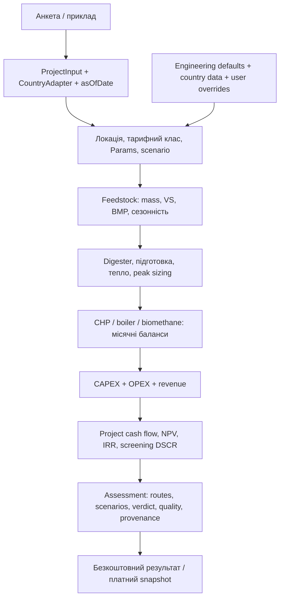

# Архітектура та карта джерел істини

Опис звірено з кодом 2026-10-29. Статус і наступні пріоритети — [current.md](current.md).
Код визначає фактичну поведінку; першоджерела й незалежна перевірка визначають,
чи вона правильна. Документація пояснює зв'язки та рішення, не дублює реєстри.

## 1. Продукт і межі

Methalytics допомагає власникам сировини, промисловим підприємствам,
операторам відходів і девелоперам оцінити, чи варто переходити до детального
біогазового/біометанового feasibility. Поточний результат — попередній screening,
не проєктна документація, банківське ТЕО або гарантія прибутковості.

Безкоштовний калькулятор → два автоматичні платні звіти → доступ за приватним
посиланням. Монетизація й entitlement: [payments.md](payments.md).
Цільові сегменти та неперевірені комерційні припущення: [market-research.md](market-research.md).
Класифікація бізнесів є поточною реалізацією, яку власник просить переглянути.

## 2. Шари й відповідальність

| Шар | Джерело істини | Відповідальність |
|---|---|---|
| Runtime і tooling | `package.json`, `package-lock.json`, `next.config.ts`, `tsconfig.json` | Версії, команди, build; Next.js App Router, React, TypeScript, Tailwind |
| Модель | `src/core/assess.ts`, `types.ts`, `context.ts` | Оркестрація розрахунку й контракти Input/Assessment; без HTTP/React/файлового I/O |
| Інженерні defaults | `src/core/engineeringParams.ts`, `feedstockData.ts`, `scenarios.ts` | Коефіцієнти, каталоги, діапазони й provenance |
| Ринки | `src/countries/index.ts`, `build.ts`, `sources.ts`, `profiles.ts`, `src/countries/data/` | CountryAdapter, офіційні ряди, fallback, тарифи, регуляторний контекст |
| Бізнес-сегменти | `src/core/businesses.ts`, `src/countries/business-markets.ts` | ID, групи, роль, scope, докази країни/регіону; не доказ попиту чи прибутку |
| Локалізація | `src/i18n/config.ts`, `index.ts`, `dict/`, тематичні каталоги | UI-мови, формати, тексти; EN — структура ключів, CoreLang — EN/UK |
| Shared context | `src/lib/preferences.ts`, `src/components/LocaleProvider.tsx`, `src/proxy.ts` | Країна проєкту, мова, валюти, локація; правила — [i18n.md](i18n.md) |
| Web/UI | `src/app/`, `src/components/`, `src/content/` | Маршрути, анкета, методологія, приклади, відображення результату |
| Server | `src/server/`, `src/app/api/` | Zod validation, city lookup/signing, orders/leads, quote, Stripe, admin auth |
| Зовнішні дані | `scripts/data/`, `src/server/data/locations.json` | Явне оновлення наборів, manifest, checksum, ліцензії; [data-sources.md](data-sources.md) |

Не вводьте нову паралельну таблицю цін, бізнесів, локалей або параметрів у UI.
Внутрішні модулі можуть імпортувати детальні core-контракти; `src/core/index.ts`
є публічним входом, а не доказом формально enforced dependency boundary.

## 3. Розрахунковий data flow

`assess` запускає маршрути та сценарії; national support cases відділені від бази.
Виняток: legacy input `assumedSupportEurPerKwh` може включити підтримку в базу;
це відкрита розбіжність із безумовною обіцянкою «без субсидій» (economics/current).
Сировина визначає газ і масштаб; назва підприємства не створює сировину.
`paramsForProject` враховує країну, регіон і клас споживання; підтверджувані
входи клієнта можуть замінювати референси. Місто змінює кліматичну основу,
але не доводить локальний тариф чи галузеву активність.

Методологія: [feedstock-model.md](feedstock-model.md) — сировина/процес,
[economics.md](economics.md) — енергія/фінанси; критерії балансів і межі —
[quality.md](quality.md). Опис технології high-rate/lagoon у результаті не
означає, що відповідний процес незалежно валідований.

`src/core/modelAudit.ts` визначає версію моделі, fallback дату статичних прикладів
і fingerprints. Live-виклики передають дату оцінки; вона не оновлює джерела.
Fingerprints виявляють зміни, але не є криптографічною гарантією чи сертифікатом.
`allProvenance` живить методологію; реєстр у Markdown не генерується.

## 4. Web і контекст

| Маршрут | Функція |
|---|---|
| `/[lang]`, `/[lang]/biogas`, `/[lang]/biogas/[slug]` | Позиціювання, цільові сегменти, редакційні матеріали |
| `/[lang]/calculator` | Бізнес → сировина → енергія → майданчик → screening |
| `/[lang]/methodology` | Реєстр параметрів вибраного ринку/локації; джерела зберігають одиниці |
| `/[lang]/samples`, `/[lang]/samples/[id]` | Змодельовані кейси з тією ж core-моделлю; не фактичні клієнтські звіти |
| `/[lang]/pricing`, `/[lang]/report/[token]` | Плани, оплата, серверна перевірка доступу й відображення snapshot |
| `/api/location`, `/api/cities` | IP-country підказка; локальний пошук GeoNames/ERA5 |
| `/api/checkout/quote`, `/api/checkout`, `/api/payments/*` | Серверна ціна, платіжна сесія, webhook/status |
| `/admin`, `/api/admin/*` | Замовлення/ліди, Basic auth; у production без credentials закрито |

Статичні й динамічні маршрути визначає код сторінок, а не припущення, що весь
сайт SSG. Збережені проєкти й оплачені snapshots не переосмислюються при
перемиканні валюти. SSR/перший client render мають отримувати однаковий snapshot;
деталі hydration, geo та форматування — у [i18n.md](i18n.md).

`businessHref` веде кожен доступний сектор на окрему `/biogas/[slug]`, зокрема
з «Для кого», footer і довідника. Існуючі editorial URL збережено; нові сторінки
беруть локалізовані назви й приклади відповідного business ID з canonical
реєстрів. Не замінювати детальний перехід якорем довідника або чужим прикладом.
Усі напрями входять до `content/segments.ts:SEGMENTS` і використовують один
`SegmentPage` та `localizedSegment`: hero → чинники → умови → FAQ → бічна
картка модельного кейсу й планів. Окремого шаблону для нових бізнесів немає.
Невідомі показники залишаються «—»; відсутній кейс не замінюється чужим.

## 5. Локація та дані

`CitySelect` → `/api/cities` → `src/server/cities.ts` → локальні GeoNames/ERA5
assets. Production-пошук не потребує зовнішнього платного API.
HMAC прив'язує кліматичний snapshot до локації; `inputSchema` перевіряє підпис
і країну. Період клімату зафіксовано в manifest, новий рік не оновлює його сам.
Репрезентативні регіональні профілі залишаються сумісними зі старими вводами;
їх не слід вважати повним адміністративним реєстром.

Ринкові дані й клімат оновлюються окремими скриптами, не при кожному запиті.
Процедура оновлення, історичні зрізи й невідомості — [data-sources.md](data-sources.md).

## 6. Платежі, безпека та спостережуваність

Backend фіксує ціну, input і Assessment перед перенаправленням у Stripe.
Платіжне підтвердження відкриває збережений результат; return URL сам по собі
не підтверджує оплату. Report token є секретом доступу, email — контактним
полем, а не акаунтом. Повний flow й edge cases — [payments.md](payments.md).

`src/lib/analytics.ts` додає події до `window.dataLayer`. Це не підтвердження
підключення GTM/GA4 або наявності виміряної конверсії. Не надсилати туди
PII, повний ввід клієнта чи приватні URL. Вбудованого LLM, що генерує розрахунки,
зараз немає; можливий AI-продуктовий шар — окрема гіпотеза, не поточна функція.

## 7. Зберігання й експлуатація

`src/server/jsonFile.ts` → `orders.ts` / `leads.ts`:
локальні JSON у `data/` або шляхах ORDERS_FILE/LEADS_FILE, tmp + rename,
послідовні записи в межах одного процесу. Це не розподілена транзакція.
Для кількох процесів/інстансів потрібне спільне надійне сховище; для одного —
persistent volume, доступ, backup і перевірений restore.
Production-конфігурацію не можна підтвердити читанням repository.

У `.env.example` — доступні налаштування, без секретів; реальні `.env*`,
замовлення й ліди не є матеріалом для документації чи очищення.
Вимоги релізу — [quality.md](quality.md).

## 8. Сталі рішення та умови перегляду

| Статус / рішення | Причина | Коли переглянути |
|---|---|---|
| Реалізовано: детерміноване ядро окремо від UI/I/O | Відтворюваність, тестованість, прозорі формули | Новий процес потребує іншої моделі; зберегти явні контракти й звірки |
| Принцип: base без subsidies, national support окремо; legacy override ще потребує узгодження | Eligibility і строки не гарантовані | За перевіреним контрактом/правом; не приховувати внесок підтримки |
| Реалізовано: language / project country / display currency / billing country розділені | Клієнт, об'єкт і платник можуть бути в різних країнах | Після UX-доказів із збереженням числового змісту |
| Реалізовано: платний assessment snapshot | Оновлення даних не переписує придбаний результат | Якщо вводиться явне версіоноване редагування/новий entitlement |
| Реалізовано: offline GeoNames/ERA5 | Без runtime-підписки та залежності від зовнішнього API | Покриття/точність/ліцензія вимагає іншого джерела |
| Тимчасово: JSON persistence | Простий один процес | До multi-instance hosting або вимог транзакційності/надійного відновлення |
| Taxonomy 2.1: 25 секторів + загальний ввід / 3 групи, роль автоматична | 30 ID зі збереженням legacy-входів; modelsForBusiness та processSchema визначають сумісну фізичну базу | Перевіряти зрозумілість із клієнтами та незалежно калібрувати процеси |
| Прийнято для знань: AGENTS + тематичні docs, CLAUDE імпортує AGENTS | Один набір правил без копій і без завантаження всього docs у контекст | Лише за реальною потребою іншого agent loader |

## 9. Як підтримувати цю архітектуру знань

На старті — AGENTS → current → потрібний тематичний документ → код/тести.
Не читати всі docs за замовчуванням. Статус/гіпотеза/рішення/числовий параметр
мають різних власників: current / market-research / ця таблиця / код із provenance.
Зміна однієї сутності не повинна вимагати редагування її копій у багатьох файлах.

Підключення агентів перевірено за
[OpenAI: AGENTS.md](https://learn.chatgpt.com/docs/agent-configuration/agents-md)
і [Claude Code: memory/imports](https://code.claude.com/docs/en/memory).
CLAUDE.md містить тільки імпорт спільної інструкції, сумісний також із сесіями,
що не читають AGENTS напряму. Тематичні docs — звичайні посилання, не eager imports.
Для іншого coding agent явно задайте AGENTS як початковий контекст, якщо його
loader не підтримує цей файл; нову копію правил не створюйте.

## Процесні входи

`ProjectInput.process` — discriminated union у `src/core/processes.ts`. Відсутність process означає каталожний AD; одночасне введення process і feedstocks відхиляється. `prepareProcess` повертає фізичний газовий потік, технологічні величини й витрати для спільного energy/finance ядра. Для нового газового входу не створюються фіктивна сировина, метантенк або добривний дохід.

`ProcessInputs` і `lib/form.ts` забезпечують locale-aware ввід та round-trip; `ProcessReport` відображає відповідні баланси, а не AD-схему для полігона. Для процесів what-if пропонує реальну зміну теплопопиту; додавання ко-субстрату до газового потоку не дозволяється. `ResultView` зберігає розподіл free/standard/full, snapshots і старі звіти залишаються читабельними. Усі меню використовують SECTOR_IDS; BUSINESS_IDS містить також legacy ID.

У process-контракті відсутні budgets/own loads позначаються ProcessResult.missingInputs та Assessment.financialsAvailable=false. Числові фінансові intermediates зі спільного ядра в цьому стані не є інвестиційним результатом; кожен renderer/export повинен перевіряти прапорець. ProcessReport, каталог прикладів і what-if не показують ці результати. Native details у калькуляторі зменшує одночасну кількість бізнес-карток; source-registry не залежить від UI.
